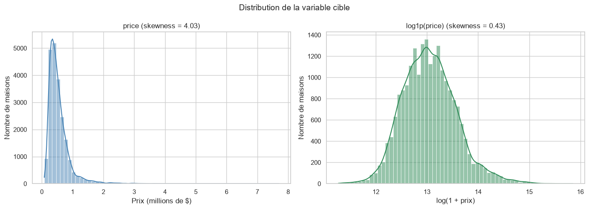
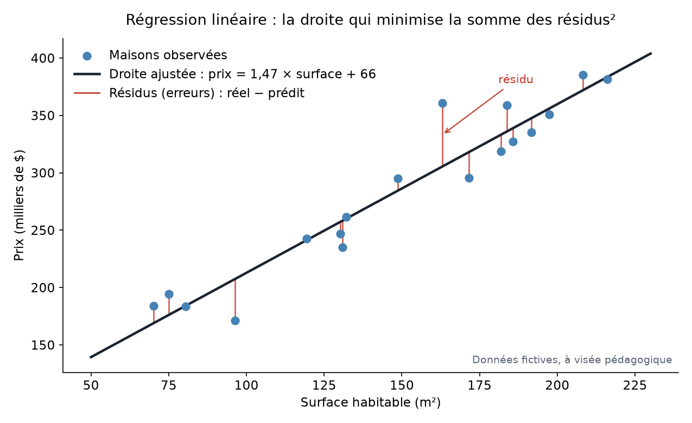
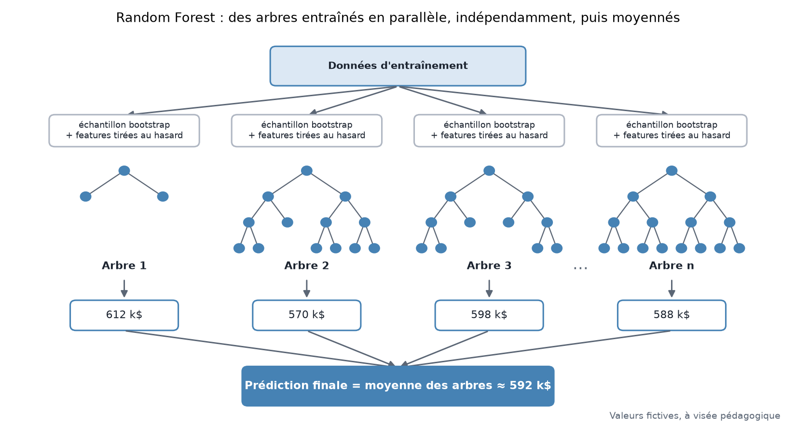
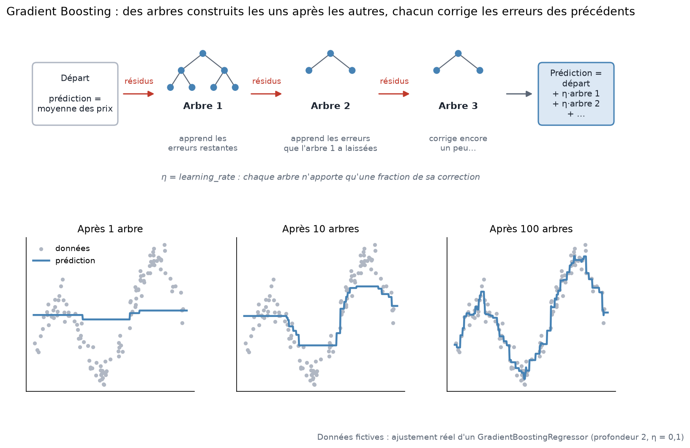
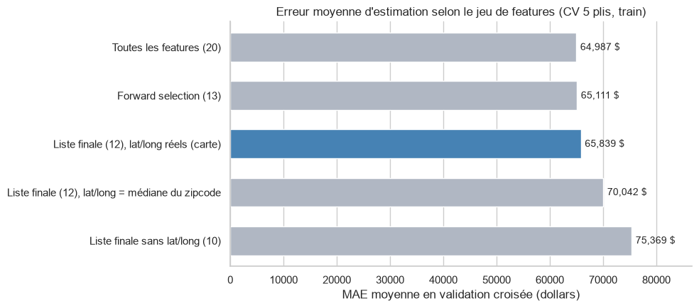
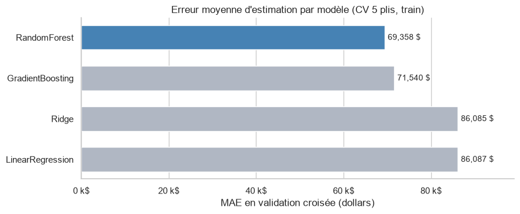
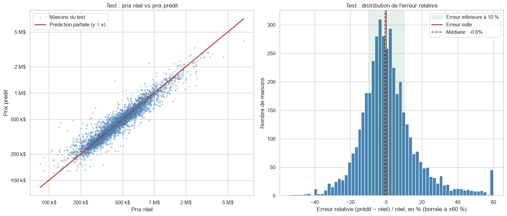
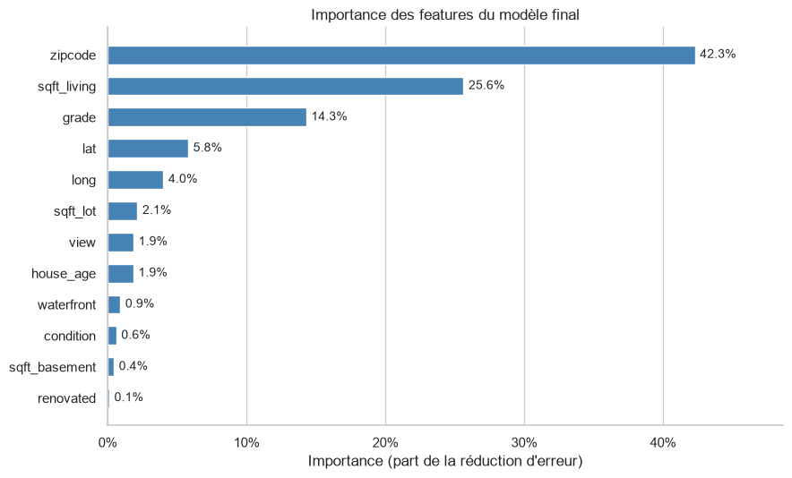

# 🏠 Apartment Hunter

**Estimer le prix d'une maison à partir de ses caractéristiques**, grâce à un modèle de machine learning entraîné sur 21 613 ventes du comté de King (Seattle) et accessible via une application web Flask, conteneurisée avec Docker.


*Projet La Plateforme, B3 IA.*

---

## Sommaire

1. [Contexte et problématique](#1-contexte-et-problématique)
2. [Équipe et organisation](#2-équipe-et-organisation)
3. [Données](#3-données)
4. [Nettoyage et préparation](#4-nettoyage-et-préparation)
5. [Analyse exploratoire](#5-analyse-exploratoire)
6. [Veille : les algorithmes de régression](#6-veille--les-algorithmes-de-régression)
7. [Sélection des variables](#7-sélection-des-variables)
8. [Modélisation](#8-modélisation)
9. [Application Flask](#9-application-flask)
10. [Déploiement Docker](#10-déploiement-docker)
11. [Structure du repository](#11-structure-du-repository)
12. [Conclusion](#12-conclusion)
13. [Reproduire le projet](#13-reproduire-le-projet)

---

## 1. Contexte et problématique

Une agence immobilière veut aider ses clients à **fixer le bon prix** pour un bien. Une estimation trop haute fait traîner la vente, une estimation trop basse fait perdre de l'argent au vendeur. Or le prix dépend de nombreuses caractéristiques (surface, qualité, état, localisation, vue, âge…) qui interagissent entre elles.

> **Problématique : peut-on estimer le prix d'un bien immobilier à partir de ses caractéristiques ?**

Il s'agit d'un problème de **régression supervisée** : prédire une valeur continue (le prix) à partir de variables explicatives. Le livrable final est un modèle exploitable via une **application web** : l'utilisateur saisit les caractéristiques d'une maison et obtient une estimation de son prix.

**Réponse courte :** oui. Sur 4 320 maisons jamais vues, le modèle final se trompe en médiane de **8,0 %** (MAE de **62 238 $**). 84 % des maisons sont estimées à moins de 20 % près (détails en [section 8](#8-modélisation)).

---

## 2. Équipe et organisation

| Membre | Rôle |
|---|---|
| **Dina Yahiaoui** | Nettoyage des données, modélisation, application Flask, Docker, README |
| **Pierre** | Veille sur les algorithmes de régression et les méthodes de sélection de variables ([section 6](#6-veille--les-algorithmes-de-régression)) |
| **Elaf** | Analyse exploratoire sous Power BI ([section 5](#5-analyse-exploratoire)) |

**Organisation :**
- **Feuille de route :** un diagramme de Gantt a planifié les étapes (données → veille → modélisation → application → Docker → documentation).
- **Suivi des tâches :** tableau Trello.
- **Git :** une branche de travail par membre.

---

## 3. Données

Nous utilisons le jeu de données **King County House Sales** (`data/raw/kc_house_data.csv`) : **21 613 ventes** de maisons dans le comté de King (région de Seattle, États-Unis), entre **mai 2014 et mai 2015**. Chaque ligne décrit une maison vendue et son prix de vente (`price`), la **variable cible**.

Le fichier ne contient **aucune valeur manquante** et **aucune ligne entièrement dupliquée**.

> **Unité :** les surfaces sont en *square feet* (**sqft**). **1 sqft ≈ 0,093 m²**, donc une maison de 1 800 sqft fait environ 167 m².

**Principales colonnes :**

| Colonne | Description |
|---|---|
| `price` | Prix de vente en dollars (**cible**) |
| `date` | Date de la vente |
| `bedrooms`, `bathrooms` | Nombre de chambres, de salles de bain (0,5 = salle d'eau sans baignoire) |
| `sqft_living` | Surface habitable totale (sqft) |
| `sqft_lot` | Surface du terrain (sqft) |
| `sqft_above`, `sqft_basement` | Surface hors sous-sol, surface du sous-sol (`sqft_living = sqft_above + sqft_basement`) |
| `floors` | Nombre de niveaux |
| `waterfront` | 1 si la maison est en bord de l'eau |
| `view` | Qualité de la vue, de 0 (aucune) à 4 (exceptionnelle) |
| `condition` | État général, de 1 (mauvais) à 5 (excellent) |
| `grade` | Qualité de construction selon l'échelle du comté, de 1 à 13 (7 = standard) |
| `yr_built`, `yr_renovated` | Année de construction, année de rénovation (0 = jamais rénovée) |
| `zipcode` | Code postal (70 codes) |
| `lat`, `long` | Latitude et longitude |
| `sqft_living15`, `sqft_lot15` | Surfaces moyennes des 15 maisons voisines |
| `id` | Identifiant de la maison |

---

## 4. Nettoyage et préparation

Tout le nettoyage est tracé et justifié dans [`notebooks/01_modelisation.ipynb`](notebooks/01_modelisation.ipynb) (section 1). La règle suivie : **avant le split train/test**, on ne fait que des traitements qui **n'apprennent rien des données** (corriger une faute évidente, appliquer une règle fixe). Tout ce qui calcule des statistiques (encodage, mise à l'échelle, sélection de variables) est fait **après le split, sur le train uniquement**, pour éviter toute fuite d'information (*data leakage*).

> Nous n'utilisons pas la version Excel préparée pour Power BI (`data/processed/KC_House.xlsx`) : elle contient 3 colonnes dérivées du prix, qui donneraient la réponse au modèle.

| Problème détecté | Décision | Justification |
|---|---|---|
| **176 `id`** apparaissent plusieurs fois (353 lignes) | **Gardées** | Aucun couple (`id`, `date`) n'est dupliqué : ce sont des **reventes** réelles à des dates différentes, pas des doublons. Limite notée : une même maison peut se trouver dans le train et dans le test (1,6 % des lignes). |
| Une maison à **33 chambres** | **Corrigée en 3** | Faute de saisie évidente : 1 620 sqft et 1,75 salle de bain, comme une maison typique de 3 chambres (médiane de 1 680 sqft). |
| **16 maisons avec 0 chambre ou 0 salle de bain** | **Supprimées** | Valeurs incohérentes pour une habitation, impossibles à deviner. Cela représente très peu de lignes (21 613 → 21 597). |
| `date` est du texte (`20141013T000000`) | Remplacée par **`sale_year`** et **`sale_month`** | Un modèle ne lit pas une chaîne. L'année capte l'évolution du marché, le mois une éventuelle saisonnalité. |
| `yr_renovated` : 0 = « jamais rénovée » | Remplacée par **`renovated`** (0/1) | Laissé tel quel, le 0 placerait les maisons non rénovées « 2 000 ans avant » les autres. 914 maisons rénovées (4,2 %). |
| `yr_built` peu parlant | **`house_age = sale_year − yr_built`**, puis **`yr_built` supprimée** | L'âge au moment de la vente est plus direct. `yr_built` devient redondante (corrélation de −0,9999 avec `house_age`). 12 âges valent −1 (ventes sur plan) : valeurs cohérentes, gardées. |
| `sqft_basement` | Ajout de **`has_basement`** (0/1) | Avoir un sous-sol ou non est une information distincte de sa surface (39,3 % des maisons). |
| `sqft_above` | **Supprimée** | `sqft_living = sqft_above + sqft_basement` sur 100 % des lignes : colinéarité parfaite, aucune information nouvelle. |
| `id` | **Supprimée** | Identifiant administratif, sans lien avec le prix. |
| `zipcode` stocké comme un nombre | Traité comme une **catégorie** | 98 039 n'est pas « plus grand » que 98 038 : 98038 a un prix médian de 342 000 $, 98039 de 1 892 500 $. L'encodage (*target encoding*) se fait **après le split**. |
| `price` très asymétrique (**skewness 4,03**) | Cible = **`log1p(price)`** (skewness **0,43**) | Le log rend la distribution presque symétrique, et le modèle minimise des erreurs **relatives** : se tromper de 10 % compte autant pour une petite maison que pour une grande. Les prédictions sont ramenées en dollars avec `np.expm1`. |



**Résultat :** `data/processed/kc_house_clean.csv`, soit **21 597 lignes × 21 colonnes** (cible `price` + 20 variables explicatives).

---

## 5. Analyse exploratoire

L'analyse exploratoire visuelle a été réalisée par **Elaf** sous **Power BI** (fichier [`powerbi/House_Hunter.pbix`](powerbi/House_Hunter.pbix)).

Le notebook complète cette analyse sur les points utiles à la modélisation : distribution de la cible (section 1.8), prix par code postal (1.9) et matrice de corrélation (3.2). Variables les plus corrélées à `log(price)` sur le train : `zipcode` encodé (0,73), `grade` (0,70), `sqft_living` (0,70), `sqft_living15` (0,62), `bathrooms` (0,55) et `lat` (0,45).

---

## 6. Veille : les algorithmes de régression

*Synthèse reformulée à partir de la veille de Pierre. Les schémas sont générés par [`docs/generer_schemas.py`](docs/generer_schemas.py) sur des données fictives.*

La **régression** consiste à prédire une variable **continue** (ici le prix) à partir de variables explicatives. Nous avons comparé quatre algorithmes, du plus simple au plus puissant.

### 6.1 Régression linéaire (et Ridge)



**Principe :** modéliser la cible comme une **somme pondérée** des variables : `prix = b₀ + b₁·x₁ + b₂·x₂ + … + bₙ·xₙ`.
- **Régression linéaire simple** : une seule variable explicative (le prix en fonction de la surface).
- **Régression linéaire multiple** : plusieurs variables à la fois (surface, chambres, âge, distance au centre…). C'est le cas le plus fréquent, car peu de phénomènes dépendent d'une seule variable.
- **Régression polynomiale** : un cas particulier de régression multiple où l'on ajoute des puissances des variables (x², x³…) pour représenter une **courbe** plutôt qu'une droite.

**Fonctionnement étape par étape :**
1. On part de coefficients `b₀ … bₙ` à déterminer.
2. Pour chaque maison, le modèle calcule une prédiction, et l'écart avec le prix réel est le **résidu** (traits rouges sur le schéma).
3. On choisit les coefficients qui **minimisent la somme des résidus au carré** (méthode des moindres carrés), avec une solution mathématique exacte.
4. Chaque coefficient se lit directement : « +1 sqft ⇒ +b₁ sur le log-prix, toutes choses égales par ailleurs ».

**Ridge** ajoute une **pénalité L2** sur la taille des coefficients (`alpha × Σ bᵢ²`). Elle « rétrécit » les coefficients vers 0, ce qui **stabilise** le modèle quand des variables sont corrélées entre elles. La pénalité dépend de l'échelle des variables : un **`StandardScaler`** est indispensable avant Ridge.

| | |
|---|---|
| **Hyperparamètres** | Aucun pour la régression linéaire ; `alpha` (force de la pénalité) pour Ridge |
| **Avantages** | Très rapide, simple, **interprétable** (un coefficient par variable), sert de point de référence |
| **Limites** | Ne capte ni les **effets non linéaires** ni les **interactions** ; sensible aux valeurs extrêmes et à la colinéarité |
| **Pertinence pour nos données** | **Baseline.** Le prix n'est pas linéaire en `lat`/`long` (ce sont des *zones* chères) et la valeur d'un sqft dépend du quartier (interaction). Résultat : MAE de 86 000 $, soit environ 15 000 $ de plus que les modèles à arbres. |

### 6.2 Random Forest



**Principe :** un **arbre de décision** découpe les données par questions successives (« `sqft_living` > 2 000 ? », « `grade` ≥ 9 ? ») et prédit, dans chaque feuille, la moyenne des maisons qui y tombent. Un arbre seul est instable : il **surapprend**. La Random Forest entraîne **beaucoup d'arbres différents** et fait la **moyenne** de leurs prédictions (méthode de *bagging*).

**Fonctionnement étape par étape :**
1. Pour chaque arbre, on tire un **échantillon bootstrap** : autant de maisons que dans le train, tirées **avec remise**.
2. À chaque coupure, l'arbre ne considère qu'un **sous-ensemble aléatoire de variables**, ce qui rend les arbres différents les uns des autres.
3. Chaque arbre est développé en profondeur, indépendamment des autres (donc **en parallèle**).
4. La prédiction finale est la **moyenne** des prédictions de tous les arbres. Les erreurs individuelles, décorrélées, se compensent.

| | |
|---|---|
| **Hyperparamètres** | `n_estimators` (nombre d'arbres), `max_depth` (profondeur), `max_features` (variables par coupure), `min_samples_leaf` |
| **Avantages** | Capte les **non-linéarités et interactions** ; robuste ; pas besoin de mise à l'échelle ; peu sensible aux réglages |
| **Limites** | Modèle **lourd** (des centaines d'arbres profonds) et plus lent à prédire ; moins interprétable ; n'extrapole pas au-delà des prix vus à l'entraînement |
| **Pertinence pour nos données** | Très bonne précision (MAE de 69 358 $ avec les réglages par défaut), mais le modèle sauvegardé pèse **308 Mo**, trop lourd pour GitHub (limite de 100 Mo par fichier) et pour une image Docker légère. |

### 6.3 Gradient Boosting



**Principe :** au lieu de moyenner des arbres indépendants, le boosting construit des arbres **peu profonds, les uns après les autres**. Chaque nouvel arbre apprend à corriger les **erreurs résiduelles** laissées par les précédents. C'est une descente de gradient sur la fonction de perte.

**Fonctionnement étape par étape :**
1. On part d'une prédiction constante : la moyenne de la cible.
2. On calcule les **résidus** (réel − prédit) de chaque maison.
3. On entraîne un petit arbre à **prédire ces résidus**.
4. On ajoute sa prédiction au modèle, multipliée par le **`learning_rate`** (η) : chaque arbre n'apporte qu'une fraction de sa correction.
5. On recommence `n_estimators` fois. Le bas du schéma montre la prédiction qui s'affine après 1, 10 puis 100 arbres.

| | |
|---|---|
| **Hyperparamètres** | `n_estimators` (nombre d'arbres), `learning_rate` (taille de chaque correction, liée à `n_estimators`), `max_depth` (ordre des interactions captées), `subsample` (part des données par arbre, qui régularise) |
| **Avantages** | Souvent le **plus précis** sur des données tabulaires ; capte non-linéarités et interactions ; modèle **léger** (arbres peu profonds) |
| **Limites** | Entraînement **séquentiel** (non parallélisable entre arbres) ; plus d'hyperparamètres à régler ; peut surapprendre si trop d'arbres ou trop profond |
| **Pertinence pour nos données** | **Modèle retenu.** Avec ses réglages par défaut, il est un peu derrière la Random Forest (71 540 $). Une fois optimisé par grid search, il devient le meilleur (63 478 $ en validation croisée, 62 238 $ sur le test) tout en pesant **4,76 Mo**. |

### 6.4 Méthodes de sélection de variables

Toutes les variables ne sont pas utiles : certaines n'apportent rien, d'autres répètent l'information d'une autre. La veille de Pierre classe les méthodes en trois familles :

| Famille | Méthode | Idée | Angle mort |
|---|---|---|---|
| **Filtres** (sans modèle) | Corrélation de **Spearman** | Les deux variables évoluent-elles ensemble ? | Ne voit que les relations monotones |
| | **Information mutuelle** | Comme Spearman, mais détecte aussi les relations **non linéaires** | Estimation bruitée (à comparer à une variable de bruit) |
| | **VIF** | Repère les variables **redondantes** (ex. `sqft_above` / `sqft_living`) | La redondance gêne surtout l'interprétation, pas la prédiction |
| **Avec modèle** | **Lasso (règle 1-SE)** | Régression qui met à zéro les coefficients inutiles ; 1-SE choisit le modèle le plus simple proche du meilleur | Favorise les variables utiles à un modèle **linéaire** |
| | **Importance par permutation** | On mélange une colonne et on mesure la baisse du score | Sous-estime deux variables corrélées |
| | **Forward selection** | On part de zéro variable et on ajoute à chaque tour la plus utile | Coûteux ; dépend de l'ordre d'ajout |
| | **RFECV** | On part de tout et on retire la moins utile à chaque tour | Coûteux |
| | **Boruta** | On crée des copies **mélangées** (donc inutiles) de chaque variable ; une variable est gardée si elle bat la meilleure copie | Lent ; bibliothèque peu maintenue (elle fonctionne ici avec NumPy 2.5.4) |

**À retenir :** aucune méthode n'est parfaite seule, chacune a ses angles morts. C'est pourquoi nous **croisons** deux méthodes complémentaires, Boruta et la forward selection ([section 7](#7-sélection-des-variables)).

---

## 7. Sélection des variables

**Méthode** (notebook, section 3) : sur le **train uniquement**, après encodage de `zipcode` par *target encoding*, nous croisons deux méthodes complémentaires :
- **Boruta** (*all-relevant*, est-ce que la variable apporte de l'information ?) : **13 variables confirmées, 7 rejetées** ;
- **Forward selection** avec un `HistGradientBoostingRegressor` (*minimal-optimal*, quel est le plus petit groupe suffisant ?) : **13 variables retenues**, pour un R² de 0,8987 contre 0,8992 avec les 20 variables, soit **aucune perte**.

Les deux méthodes s'accordent sur 10 variables : `zipcode`, `grade`, `sqft_living`, `lat`, `long`, `view`, `waterfront`, `sqft_lot`, `house_age` et `condition`.

**Second critère, l'utilisabilité :** chaque variable du modèle doit pouvoir être **saisie par un utilisateur** dans le formulaire. On compare plusieurs listes par validation croisée à 5 plis sur le train (`HistGradientBoostingRegressor`, encodage refait dans chaque pli) :

| Jeu de variables | R² (log) | MAE |
|---|---|---|
| Toutes les variables (20) | 0,9026 | 64 987 $ |
| Forward selection (13) | 0,9014 | 65 111 $ |
| **Liste finale (12), lat/long réels (carte)** | **0,8994** | **65 839 $** |
| Liste finale (12), lat/long = médiane du code postal | 0,8879 | 70 042 $ |
| Liste finale sans lat/long (10) | 0,8748 | 75 369 $ |



**Lecture :** la liste finale coûte seulement **+1,3 %** de MAE par rapport aux 20 variables. En revanche, `lat`/`long` sont décisives : sans elles, la MAE augmente de **14 %**. D'où le choix d'une **carte** dans l'application, où l'utilisateur clique sur l'emplacement exact, avec la médiane du code postal (calculée sur le train) comme valeur par défaut.

**Les 12 variables finales :**

| Variable | Performance | Saisie dans le formulaire |
|---|---|---|
| `sqft_living` | Boruta + forward ; 3ᵉ corrélation (0,70) | Nombre (sqft, avec l'équivalent en m²) |
| `grade` | Boruta + forward ; 2ᵉ corrélation (0,70) | Liste déroulante avec libellés (7 = Standard) |
| `zipcode` | Boruta + forward ; 1ʳᵉ corrélation une fois encodé (0,73) | Liste des 70 codes connus |
| `lat`, `long` | Boruta + forward ; effet non linéaire fort | Clic sur une carte Leaflet ; par défaut, médiane du code postal |
| `view` | Boruta + forward | Liste déroulante (0 à 4) |
| `waterfront` | Boruta + forward | Case à cocher |
| `sqft_lot` | Boruta + forward | Nombre (sqft) |
| `condition` | Boruta + forward | Liste déroulante (1 à 5) |
| `house_age` | Boruta + forward | L'utilisateur saisit l'**année de construction** ; âge = 2015 − année |
| `sqft_basement` | Forward seulement (petit gain) | Nombre, 0 s'il n'y a pas de sous-sol |
| `renovated` | Forward seulement (petit gain) | Case à cocher |

**Les 8 variables exclues :**

| Variable | Raison |
|---|---|
| `sqft_living15`, `sqft_lot15` | **Impossibles à saisir** (moyennes des 15 voisins) ; la forward selection les juge redondantes avec `sqft_living`, `sqft_lot` et `zipcode` |
| `bathrooms` | Informative (Boruta) mais redondante avec `sqft_living` et `grade` (forward : non) |
| `bedrooms`, `floors` | Rejetées par les deux méthodes : l'information est déjà portée par `sqft_living` |
| `has_basement` | Rejetée par les deux méthodes ; redondante avec `sqft_basement` (r = 0,82) |
| `sale_month` | Rejetée par les deux méthodes |
| `sale_year` | Petit gain en forward, mais sans sens dans un formulaire ; les estimations correspondent aux prix de 2014-2015 |

---

## 8. Modélisation

### 8.1 Protocole

1. **Split train/test 80/20** (`random_state=42`) **avant tout traitement qui apprend des données** : 17 277 maisons pour l'entraînement, 4 320 pour le test. Le test n'est utilisé **qu'une seule fois**, à la fin.
2. **Pipelines scikit-learn** : `ColumnTransformer` avec `TargetEncoder` (cross-fitting à 5 plis) + `StandardScaler` sur `zipcode`, et `StandardScaler` sur les autres variables, puis le modèle. Le pipeline est **réajusté dans chaque pli** de validation croisée, ce qui évite toute fuite. Le même objet est sauvegardé et utilisé par l'application.
3. **Validation croisée à 5 plis** (`KFold`, mélangés, `random_state=42`) sur le train, avec `cross_val_predict`.
4. **Métriques** : MAE et RMSE **en dollars** (après `np.expm1`), R² sur `log(price)`.

### 8.2 Comparaison des 4 modèles (validation croisée, train)

| Modèle | MAE | RMSE | R² (log) |
|---|---|---|---|
| **RandomForest** (200 arbres) | **69 358 $** | 131 716 $ | **0,8875** |
| GradientBoosting (défaut) | 71 540 $ | **130 295 $** | 0,8866 |
| Ridge (`alpha=1.0`) | 86 085 $ | 194 258 $ | 0,8553 |
| LinearRegression (baseline) | 86 087 $ | 194 289 $ | 0,8553 |



- **Les modèles à arbres font nettement mieux** (environ −15 000 $ de MAE) : la localisation agit par zones, et les variables interagissent entre elles (un sqft vaut plus à Bellevue qu'au sud du comté).
- **Ridge n'apporte rien** par rapport à LinearRegression : avec 17 000 maisons pour 12 variables peu colinéaires, il n'y a presque rien à régulariser.

**Pourquoi optimiser le GradientBoosting plutôt que la RandomForest, pourtant 1ʳᵉ ?**
1. **L'écart est faible** (3 % de MAE), et le GradientBoosting a déjà une RMSE plus basse.
2. **Ses réglages par défaut sont prudents** (100 arbres de profondeur 3) : il a la plus grande marge de progression.
3. **Le déploiement** : une fois sauvegardé, la RandomForest pèse **308,3 Mo**, contre **0,1 Mo** pour le GradientBoosting par défaut.

### 8.3 Optimisation par grid search

`GridSearchCV` sur le pipeline complet : 16 combinaisons × 3 plis = 48 entraînements (1,8 min), `scoring="neg_mean_absolute_error"`.

| Hyperparamètre | Valeurs testées | **Meilleure valeur** |
|---|---|---|
| `n_estimators` | 300, 600 | **600** |
| `learning_rate` | 0,05 ; 0,1 | **0,05** |
| `max_depth` | 4, 6 | **6** |
| `subsample` | 0,8 ; 1,0 | **0,8** |

**Comparaison finale en validation croisée à 5 plis** (même protocole qu'en 8.2) :

| Modèle | MAE | RMSE | R² (log) |
|---|---|---|---|
| **GradientBoosting optimisé** | **63 478 $** | **114 462 $** | **0,9021** |
| RandomForest (référence) | 69 358 $ | 131 716 $ | 0,8875 |
| GradientBoosting par défaut | 71 540 $ | 130 295 $ | 0,8866 |

Le modèle optimisé bat la RandomForest de **8,5 %** en MAE et de **13 %** en RMSE. **C'est le modèle final.**

### 8.4 Résultats sur le jeu de test (évaluation unique)

| Métrique | Validation croisée (train) | **Test (4 320 maisons)** |
|---|---|---|
| MAE | 63 478 $ | **62 238 $** |
| RMSE | 114 462 $ | **119 825 $** |
| R² (log) | 0,9021 | **0,9041** |
| Erreur relative médiane | 8,3 % | **8,0 %** |
| Maisons estimées à moins de 10 % près | 57,3 % | **58,4 %** |
| Maisons estimées à moins de 20 % près | 83,2 % | **84,4 %** |

**Pas de surapprentissage :** les scores du test sont très proches de ceux de la validation croisée. Seule la RMSE est un peu plus élevée, à cause de quelques maisons de luxe (jusqu'à 7 M$) sur lesquelles l'erreur en dollars est forcément grande.



- L'erreur est **centrée sur 0** (médiane −0,6 %) et resserrée autour de ±10 %.
- **Retour vers la moyenne** : les 20 % de maisons les moins chères sont surestimées de 3,3 % (médiane) et les 20 % les plus chères sous-estimées de 4,0 %.
- 40 maisons ont plus de 60 % d'erreur : ce sont surtout des biens vendus très en dessous de leur valeur apparente, un contexte de vente que les données ne décrivent pas.

### 8.5 Importance des variables



| Groupe | Variables | Importance |
|---|---|---|
| **Localisation** | `zipcode` (42,3 %), `lat` (5,8 %), `long` (4,0 %) | **52 %** |
| **Surface** | `sqft_living` | 25,6 % |
| **Qualité de construction** | `grade` | 14,3 % |
| Ajustements fins | `sqft_lot` (2,1 %), `view` (1,9 %), `house_age` (1,9 %), `waterfront` (0,9 %), `condition` (0,6 %) | 7,4 % |
| Quasi inutilisées | `sqft_basement` (0,4 %), `renovated` (0,1 %) | 0,5 % |

« L'emplacement, l'emplacement, l'emplacement » : la localisation domine, suivie de la surface et de la qualité. L'importance de `zipcode` est en partie gonflée par construction, car son *target encoding* résume déjà le niveau de prix de la zone.

**Modèle sauvegardé :** [`models/model.joblib`](models/model.joblib) (pipeline complet, **4,76 Mo**) et [`models/metadata.json`](models/metadata.json) (variables, 70 codes postaux, hyperparamètres, métriques du test, versions de Python et de scikit-learn, date d'entraînement).

---

## 9. Application Flask

L'application ([`app/`](app/)) permet d'estimer le prix d'une maison depuis un navigateur.

**Fonctionnalités :**
- **Formulaire des 12 variables**, avec des libellés en français et des aides :
  - surfaces en sqft avec l'**équivalent en m² affiché en direct** ;
  - listes déroulantes avec libellés (qualité de construction, état, vue) ;
  - cases à cocher (bord de l'eau, rénovée) ;
  - année de construction (l'âge est calculé automatiquement).
- **Carte Leaflet** (tuiles OpenStreetMap) :
  - choisir un code postal recentre la carte sur la médiane de la zone ;
  - un clic, ou le déplacement du marqueur, place la maison précisément ;
  - sans clic, la médiane du code postal est utilisée.
- **Validation côté serveur** de chaque champ (types, bornes, cohérence sous-sol / surface, point dans le comté), avec des messages d'erreur clairs. Le formulaire conserve les valeurs saisies.
- **Résultat mis en avant** :
  - prix estimé (ex. **581 568 $** pour la maison exemple) ;
  - **fourchette indicative ±8 %**, l'erreur médiane du test lue dans `metadata.json` ;
  - rappel « Estimation basée sur les ventes 2014-2015 du comté de King (Seattle) ».
- Mise en page en **2 colonnes** (formulaire / carte) sur grand écran, **responsive** sur mobile, sans framework CSS, avec un mode sombre automatique.
- **Chargement unique** du modèle au démarrage, avec des chemins construits par `pathlib` depuis `app.py` (fonctionne quel que soit le dossier courant, et dans Docker).

**Lancement en local (PowerShell, à la racine du projet) :**

```powershell
.venv\Scripts\Activate.ps1
python app\app.py
```

Puis ouvrir **http://127.0.0.1:5000**. Le mode debug est désactivé par défaut (`$env:FLASK_DEBUG = "1"` pour l'activer). La carte nécessite une connexion internet (Leaflet et tuiles OpenStreetMap).

---

## 10. Déploiement Docker

**Pourquoi Docker ?** L'application tourne de la même façon sur n'importe quelle machine : même version de Python, mêmes bibliothèques (en particulier **scikit-learn 1.9.1**, indispensable pour recharger le modèle `joblib`), sans rien installer d'autre que Docker.

> **Note :** le fichier s'appelle **`Dockerfile`** (nom standard reconnu automatiquement par Docker), et non `.dockerfile`.

**Construire et lancer (à la racine du projet) :**

```powershell
docker build -t apartment-hunter .
docker run -d -p 5000:5000 --name apartment-hunter apartment-hunter
```

Puis ouvrir **http://127.0.0.1:5000**. Si le port 5000 est déjà pris sur la machine, utiliser `-p 5001:5000` et ouvrir http://127.0.0.1:5001.

```powershell
docker logs apartment-hunter     # voir les logs
docker stop apartment-hunter     # arrêter
docker rm apartment-hunter       # supprimer le conteneur
```

**Choix techniques :**

| Choix | Pourquoi |
|---|---|
| Image **`python:3.13-slim`** | Même version de Python que l'environnement d'entraînement, variante allégée |
| **[`app/requirements.txt`](app/requirements.txt) minimal** (6 paquets, versions identiques au `.venv`) | Le `requirements.txt` de la racine contient tout l'environnement de travail (Jupyter, Boruta, matplotlib, seaborn…) : image plus lourde et plus longue à construire, pour rien |
| Copie de `requirements.txt` **avant** le code | Docker met en cache l'installation des dépendances : un changement de code ne réinstalle pas les paquets |
| Copie de **`app/` et `models/` uniquement** | L'image ne contient que ce qui sert à l'application |
| **gunicorn** (2 workers) au lieu du serveur Flask | Le serveur intégré de Flask est réservé au développement. Gunicorn est un serveur de production : plusieurs processus en parallèle, relance automatique en cas de plantage |
| **Utilisateur non-root** (`appuser`) | Bonne pratique de sécurité : le processus n'a pas les droits administrateur dans le conteneur |
| **[`.dockerignore`](.dockerignore)** | Exclut `.venv`, `.git`, `data/`, `notebooks/`, `powerbi/`… du contexte de build : build plus rapide, aucun fichier inutile ou sensible dans l'image |

**Vérifié :** dans le conteneur, la maison exemple donne bien **581 568 $**. L'image pèse 646 Mo sur disque, surtout à cause de scikit-learn, SciPy, NumPy et pandas.

---

## 11. Structure du repository

```
apartment-hunter/
├── README.md                     # ce document
├── Dockerfile                    # image Docker de l'application
├── .dockerignore                 # fichiers exclus du build Docker
├── .gitignore
├── requirements.txt              # environnement complet (notebook + app)
├── data/
│   ├── raw/
│   │   └── kc_house_data.csv     # dataset brut (21 613 ventes)
│   └── processed/
│       ├── kc_house_clean.csv    # dataset nettoyé (21 597 × 21)
│       └── KC_House.xlsx         # version Power BI (non utilisée pour la modélisation)
├── notebooks/
│   └── 01_modelisation.ipynb     # notebook principal : nettoyage → sélection → modèles → test
├── models/
│   ├── model.joblib              # pipeline complet (encodage + scaling + GradientBoosting)
│   ├── metadata.json             # variables, codes postaux, métriques, versions
│   └── zipcode_latlong.csv       # médiane lat/long par code postal (train)
├── app/
│   ├── app.py                    # application Flask
│   ├── requirements.txt          # dépendances minimales de l'app (Docker)
│   ├── templates/
│   │   ├── base.html
│   │   └── index.html
│   └── static/
│       ├── style.css
│       └── script.js
├── docs/
│   ├── generer_schemas.py        # génère les 3 schémas de la veille
│   ├── extraire_figures.py       # extrait les graphiques du notebook pour le README
│   ├── schema_*.png              # schémas pédagogiques (régression, Random Forest, Gradient Boosting)
│   └── fig_*.png                 # graphiques de résultats du notebook
└── powerbi/
    └── House_Hunter.pbix         # dashboard d'analyse exploratoire (Elaf)
```

---

## 12. Conclusion

### Réponse à la problématique

**Oui, on peut estimer le prix d'un bien immobilier à partir de ses caractéristiques**, avec une bonne précision pour la grande majorité des biens. À partir de **12 caractéristiques** qu'un particulier peut renseigner, le modèle final estime le prix d'une maison jamais vue avec :
- une **erreur médiane de 8,0 %** ;
- une **MAE de 62 238 $** ;
- **84 %** des maisons estimées à moins de 20 % près.

Le prix dépend avant tout de la **localisation**, puis de la **surface** et de la **qualité de construction**.

### Limites

- **Des prix de 2014-2015 :** les estimations correspondent au marché de mai 2014 à mai 2015 dans le comté de King. Elles ne sont valables ni aujourd'hui, ni dans une autre région.
- **Les reventes :** 1,6 % des lignes concernent des maisons vendues plusieurs fois, qui peuvent être à la fois dans le train et dans le test. Vu cette faible proportion, l'effet sur les scores est négligeable.
- **Des maisons de luxe sous-estimées :** au-delà de 2 M$, le modèle sous-estime les prix (−4,0 % en médiane sur le quintile le plus cher). Ces biens sont rares et dépendent de caractéristiques absentes des données.
- **La saisie de `lat`/`long` :** la précision suppose que l'utilisateur place la maison sur la carte. Avec la médiane du code postal, la MAE passe d'environ 65 800 $ à 70 000 $ (validation croisée).
- **Des facteurs non observés :** l'état intérieur détaillé et le contexte de vente (succession, vente forcée) expliquent les rares erreurs très fortes.

### Pistes d'amélioration

- **Une fourchette par quantiles** plutôt qu'un ±8 % fixe : régression quantile (`loss="quantile"`) ou quantiles 10 % et 90 % des erreurs observées, pour afficher une fourchette à 80 %.
- **Un split groupé par `id`** (`GroupShuffleSplit`), pour qu'une maison revendue soit entièrement dans le train ou entièrement dans le test, et éliminer totalement l'effet des reventes.
- **Élargir le grid search** : le meilleur réglage est au bord de la grille (plus d'arbres, profondeur 8, `learning_rate` 0,02), ou passer à une recherche aléatoire ou bayésienne (Optuna).
- **Tester d'autres algorithmes de boosting** : `HistGradientBoostingRegressor`, XGBoost, LightGBM, souvent plus rapides et un peu plus précis.
- **Enrichir les données** : distance au centre ou à l'eau, écoles, transports, et surtout des **ventes récentes**.
- **Mieux traiter le haut de gamme** : pondération ou modèle dédié.
- **Simplifier le formulaire** : `sqft_basement` et `renovated` pèsent moins de 0,5 % de l'importance.

---

## 13. Reproduire le projet

**Prérequis :** Python 3.13, Git, et Docker pour la dernière étape.

```powershell
# 1. Cloner le repository
git clone https://github.com/dina-yahiaoui/apartment-hunter.git
cd apartment-hunter

# 2. Créer et activer l'environnement virtuel
python -m venv .venv
.venv\Scripts\Activate.ps1

# 3. Installer l'environnement complet (notebook + application)
pip install -r requirements.txt
```

**Ordre d'exécution :**

| Étape | Commande / action | Produit |
|---|---|---|
| 1. Modélisation | Ouvrir `notebooks/01_modelisation.ipynb` et **exécuter toutes les cellules** (quelques minutes, dont Boruta et le grid search) | `data/processed/kc_house_clean.csv`, `models/model.joblib`, `models/metadata.json`, `models/zipcode_latlong.csv` |
| 2. Figures du README (optionnel) | `python docs/generer_schemas.py` puis `python docs/extraire_figures.py` | Images de `docs/` |
| 3. Application en local | `python app\app.py`, puis http://127.0.0.1:5000 | Application web |
| 4. Docker | `docker build -t apartment-hunter .` puis `docker run -d -p 5000:5000 --name apartment-hunter apartment-hunter` | Application conteneurisée |

> Toutes les opérations aléatoires utilisent `random_state=42` : les résultats sont reproductibles avec les versions de `requirements.txt`.
